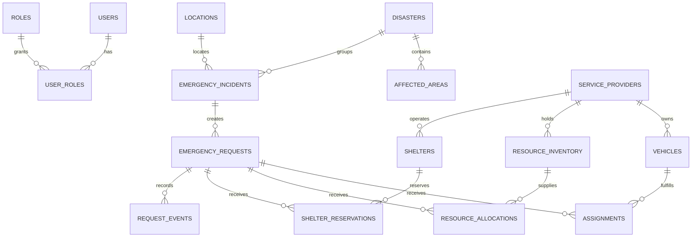

# CrisisGrid data model

## Scope and terminology

The schema separates a broad **disaster** from a reported **incident**, a specific assistance **request**, an exclusive vehicle **assignment**, and quantity/capacity **allocations**.

## Normalization

- **1NF:** Locations, roles, resource types, and statuses are atomic values rather than comma-separated fields.
- **2NF:** Many-to-many relationships use `user_roles` and `assignment_responders`.
- **3NF:** Providers, vehicles, inventory, shelters, requests, assignments, events, and audits are separate concepts. Operational counts are derived rather than copied onto requests.

`resource_inventory.reserved_quantity` and `shelters.reserved_count` are deliberate operational counters. Phase 6 will change them only inside row-locked transactions alongside allocation/reservation rows.

## Geospatial model and safeguards

- `locations.coordinates` uses `geography(Point, 4326)` for metre-based `ST_DWithin` and `ST_Distance` searches.
- `affected_areas.boundary` uses `geometry(MultiPolygon, 4326)` for regional boundaries.
- Coordinate SRID and legal longitude/latitude are checked; all user-supplied points must be constructed with `make_wgs84_geography(longitude, latitude)`, which rejects values outside legal bounds before PostGIS can normalize them.
- GiST indexes cover searchable points and polygons. Nearby-resource distances are straight-line metres, never a route ETA.
- UUID keys, foreign keys, enums, positive quantities, capacity checks, and the active-assignment partial unique index protect core data integrity.

## Referential actions

Historical operational parents use `RESTRICT`; optional actors use `SET NULL`; dependent role/event rows use `CASCADE`. This preserves the record while minimizing unnecessary retained personal data.
